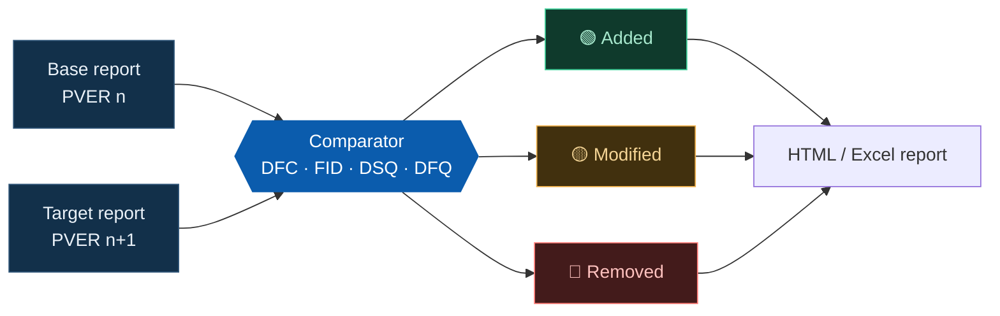
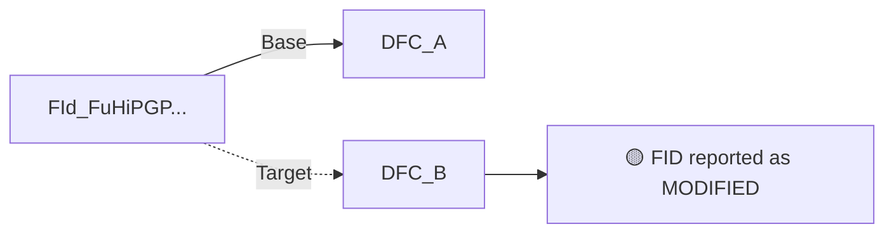

<p align="center">
  
</p>

<p align="center">
  
  
  
  
</p>

> Automated DSM report comparison tool for identifying diagnostic changes between two PVER releases.

DSM Report Comparator compares DSM reports from two PVER releases and generates a detailed diagnostics delta report. It reduces manual review effort during software releases, regression analysis, and diagnostics impact assessments.

## What it detects

| | Change | Description |
|---|---|---|
| 🟢 | **Added** | Diagnostics present only in the target release |
| 🔴 | **Removed** | Diagnostics present only in the baseline release |
| 🟡 | **Modified** | FID changes, DFC mapping changes, description and configuration updates |

## How it works



## Prerequisites

> [!NOTE]
> Python 3.10 or later and your DSM report files (`.txt`) are required.

| Required | Recommended |
|---|---|
| Python 3.10+ | Microsoft Excel (for `.xlsx` reports) |
| DSM report files | Chrome, Edge, or Firefox (for HTML reports) |

Verify your Python installation:

```bash
python --version
# Python 3.x.x
```

## Quick start


1. Select the baseline DSM report.
2. Select the target DSM report.
3. Choose the output format: **HTML**, **Excel**, or **HTML + Excel**.
4. Run the comparison.
5. Review the generated diagnostics comparison report.

## Features

### Case-insensitive prefix support

Prefixes are matched in any letter case. Original entity names are preserved, so comparison accuracy is maintained across DSM generator variants.

| Entity | Example matches |
|---|---|
| DFC | `DFC_` `dfc_` `DfC_` |
| FID | `FID_` `FId_` `fid_` |
| DSQ | `DSQ_` `dsq_` |
| DFQ | `DFQ_` `dfq_` |

Example: `FId_FuHiPGPCtrlDeCatHeatgMin`

### Intelligent FID change detection

A FID is reported as **MODIFIED** when its DFC association changes, even if the description, scheduling parameters, and IUMPR fields stay the same.



> [!TIP]
> FID-to-DFC mapping changes are also reported separately in the mapping analysis section for full traceability.

### Description handling

- Generated metadata such as `LongName_EN` is removed from descriptions.
- Empty or missing descriptions are shown as `Not Available`.

## Input and output

> [!IMPORTANT]
> Source DSM reports are never modified. All analysis runs in read-only mode and output files are written separately.

Input files use the `.txt` format, for example `Base_dsm_report.txt` and `Target_dsm_report.txt`.

Reports are saved in an automatically created `Output` subfolder inside the folder selected in the **Output** field. If the field is empty, the target report's folder is used as the parent. The **Open Output Folder** button opens this subfolder.

| Format | File |
|---|---|
| HTML | `Comparison_Report.html` |
| Excel | `Comparison_Report.xlsx` |
| HTML + Excel | Both files |

<details>
<summary><b>Project structure</b></summary>

```text
DSM-Report-Comparator/
├── DSM_Comparator.py
├── DSM_Comparator.pyw   (to be executed with python.exe)
├── README.md
├── docs/
│   └── hero.svg
├── Input/
│   ├── dsm_report_1.txt
│   └── dsm_report_2.txt
├── Output/
│   ├── Comparison_Report.html
│   └── Comparison_Report.xlsx
└── logs/
```

</details>

<details>
<summary><b>What's new in 2.0</b></summary>

| Type | Change |
|---|---|
| 🟢 Added | Case-insensitive handling of DFC, FID, DSQ, and DFQ prefixes |
| 🟢 Added | Support for mixed-case FID identifiers (`FID_`, `FId_`, etc.) |
| 🟢 Added | FID change detection based on DFC mapping modifications |
| 🔵 Improved | Automatic removal of metadata suffixes such as `LongName_EN` |
| 🔵 Improved | Consistent handling of empty or NULL descriptions using `Not Available` |
| 🟠 Fixed | Missing FID detection caused by mixed-case prefixes |
| 🟠 Fixed | FID modifications not reported when only DFC associations changed |

</details>

## Benefits

- ✅ Faster diagnostics review
- ✅ Reduced manual comparison effort
- ✅ Improved release analysis
- ✅ Better traceability of diagnostic changes
- ✅ Consistent reporting across DSM generator versions
- ✅ Read-only processing of source DSM reports

## License

RB Internal Engineering Tool.
